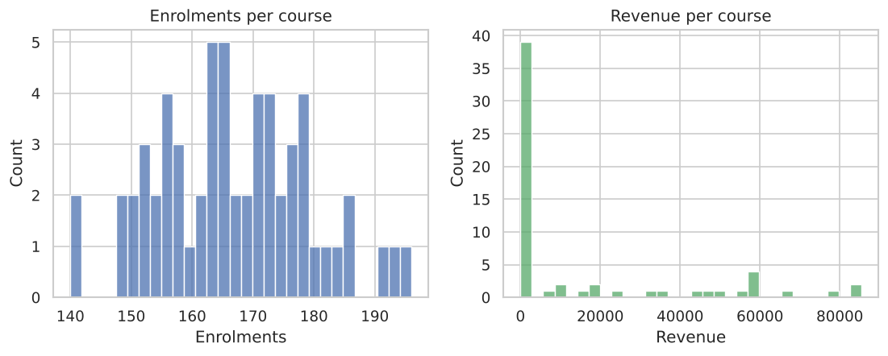
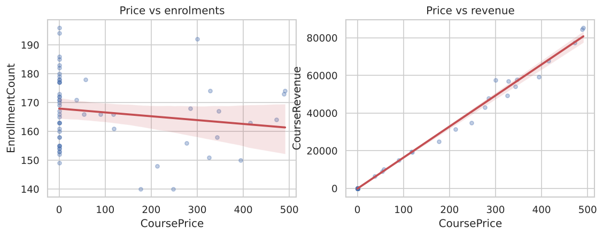
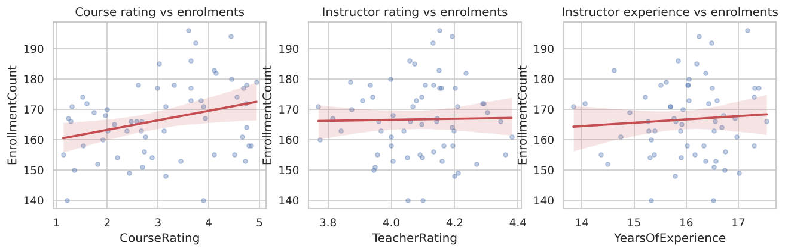
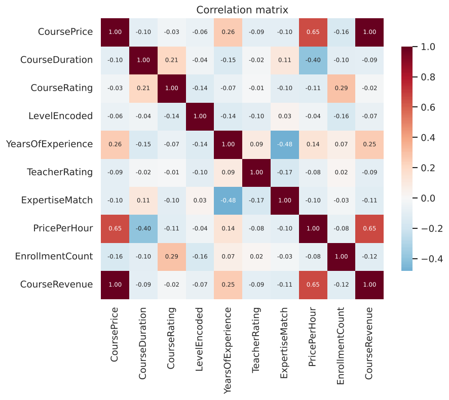
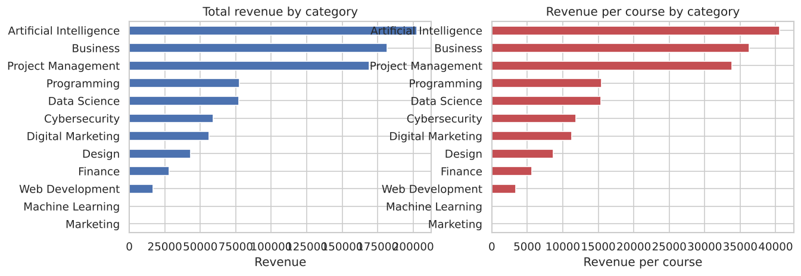
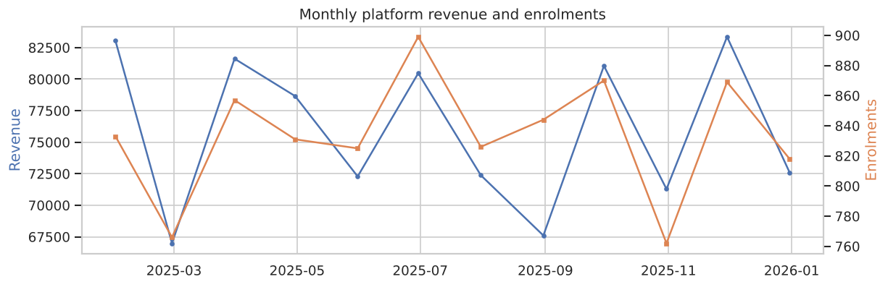

> # ⚠️ Headline finding
>
> **This dataset does not support course-level demand prediction, and the honest
> deliverable is to say so rather than to report a model.**
>
> Enrolment counts across the 60 courses are statistically
> indistinguishable from 10,000 transactions being allocated to courses
> at random (index of dispersion 0.941, where 1.00 is pure
> chance; χ² = 55.52, df = 59, p = 0.6046). No
> course attribute is associated with enrolment once corrected for multiple testing. The
> best enrolment model scores **R² = +0.009** on hold-out courses,
> which is no better than predicting the average.
>
> Revenue *appears* highly predictable (R² up to +0.970), but this is
> arithmetic, not prediction: `Amount` equals `CoursePrice` on every one of the
> 10,000 transactions, so revenue is exactly price × enrolments. A rule
> with **no model at all** — price × the average enrolment count — scores
> **R² = +0.989** and beats every fitted model in the comparison.
>
> The pipeline, dashboard and methodology below are complete and correct. What they
> demonstrate is that the *data* cannot answer the question asked of it.

---

# Predictive Modeling for Course Demand and Revenue Forecasting on EduPro

**Research paper**

**Author:** Gauri Shinde, Second-year Computer Science student, University of Greenwich

Generated 2026-10-24 · pipeline runtime 129.9s

---

## Abstract

This study attempts course-level prediction of enrolment demand and revenue for the EduPro
platform, using 60 courses, 10,000 transactions,
60 instructors and 12 categories
covering 2025-01-01 to
2025-12-30.

Before fitting any model, four diagnostics tested whether the targets contain learnable
structure. They do not, for enrolment. Enrolment counts have an index of dispersion of
0.941 against a value of 1.00 for a pure counting process, and a
goodness-of-fit test cannot reject the hypothesis that every course draws from the same
constant rate (p = 0.6046). Of 17 attribute-to-enrolment
association tests, none survives Bonferroni correction.

Six regression families were nevertheless fitted, to confirm the diagnosis rather than to
deploy. The best enrolment model reaches R² = +0.009 on hold-out courses
against -0.034 for a mean-predicting baseline: it has learned
nothing.

Revenue is a different failure. Because `Amount` equals `CoursePrice` exactly on every
transaction, revenue is arithmetically price × enrolments. Models report R² up to
+0.970, but the naive rule *price × average enrolments*, which requires
no fitting, reaches +0.989 with a mean absolute error of
1,724 against 3,017 for the best learned
model. Every model in the comparison is beaten by arithmetic.

The contribution of this paper is therefore a negative result, established with explicit
tests, together with a specification of what the platform would have to record for the
original question to become answerable.

---

## 1. Introduction

EduPro commissions courses, prices them and onboards instructors before any sales data for
those courses exists. The brief asks for predictive models of enrolment demand and revenue
so those decisions can be made on forecasts rather than on retrospective reporting.

The analysis addresses three questions in order:

1. **Is there anything to learn?** Do enrolment counts vary more than chance allocation
   would produce, and does any course attribute track that variation?
2. If so, how accurately can enrolment and revenue be predicted from attributes known at
   commissioning time?
3. Which attributes drive demand?

Question 1 is asked first deliberately. A regression pipeline returns a number whatever it
is given, and a model fitted to noise still reports an R². Asking question 2 before question
1 is how noise gets published as insight.

---

## 2. Data

### 2.1 Source

Workbook: `EduPro Online Platform.xlsx`
Sheets: Users, Teachers, Courses, Transactions

| Table | Rows | Columns |
|---|---|---|
| Courses | 60 | 8 |
| Teachers | 60 | 7 |
| Transactions | 10,000 | 7 |
| Users | 3,000 | 5 |

Transaction window: 2025-01-01 to
2025-12-30.

### 2.2 Three structural features that shape everything downstream

**(a) The catalogue has no instructor.** The Courses sheet carries no `TeacherID`. The only
Course↔Teacher link in the workbook is on the Transactions sheet, and it is not an ownership
link: the median course has **14 distinct
instructors** against it and the maximum has 30.
The `TeacherID` is attached to the sale, not to the course.

Instructor attributes were therefore averaged per course. Averaging across ~14 instructors
collapses the variation: instructor rating has a standard deviation of
0.95 across the 60
instructors, but only 0.142 across courses after
aggregation — **14.9% of the signal survives**. Any
instructor feature in this analysis is close to a constant.

This means the brief's "expertise-category match score" and "instructor rating influence"
cannot be evaluated as specified. The data does not record who teaches what.

**(b) Nearly two thirds of the catalogue is free.**
38 of 60 courses
(63.3%) have a list price of zero and therefore generate
exactly zero revenue regardless of demand. The median course revenue is
0. Revenue at course level is close to a binary
free/paid indicator multiplied by a price.

**(c) `Amount` never deviates from `CoursePrice`.** On all 10,000
transactions the amount paid equals the course's list price to the cent. There are no
discounts, no partial payments and no promotions in this data. Consequences are developed in
section 4.4.

### 2.3 Data quality

- Duplicate rows removed: {'courses': 0, 'teachers': 0, 'transactions': 0}
- Transactions dropped for a missing CourseID or date: 0
- Transactions referencing an unknown CourseID: 0
  (0.0%)
- Courses with zero transactions: 0

The referential integrity is perfect, which is itself worth noting: every transaction
resolves to a real course, user and instructor.

---

## 3. Methodology

### 3.1 Two framings

**Cold-start** models use course and instructor attributes only, with no historical
performance features. This is the information available when commissioning a course that
does not yet exist.

**Temporal forecasting** models cut the ledger at **2025-09-30**, build
features from the 8.9 months before it and predict the
3.0 months after. No feature can see its own target.

The separation matters because the brief lists "past enrolment count" as a feature while
also listing enrolment count as a target. Computed over one period those are the same
number, and a model built that way reports a near-perfect R² while forecasting nothing.

### 3.2 Preprocessing

Numeric features median-imputed and standardised; categoricals mode-imputed and one-hot
encoded, all inside a scikit-learn `Pipeline` so encoders refit within each cross-validation
fold. Numeric pairs correlated above |r| = 0.95 were pruned, with
headline business levers protected from removal.

### 3.3 Models

Six families per target: mean baseline, Linear Regression, Ridge, Lasso, Random Forest,
Gradient Boosting. Ridge, Lasso and the ensembles were tuned by grid search over
5-fold cross-validation, each fitted on both raw and log1p targets with the
better cross-validated variant kept. **Winners were selected on cross-validated R², never on
the hold-out score**, so the reported test metrics are not inflated by selection.

For revenue an additional non-model benchmark was added: *price × mean training enrolments*.
Where revenue is arithmetically determined by price, the mean is the wrong thing to beat.

---

## 4. Signal diagnostics

These ran before any model was fitted.

### 4.1 Dispersion: is enrolment variance larger than chance?

If 10,000 transactions were sprinkled at random across
60 courses, each course would still receive a different number purely by
chance, and the variance of that null process is known. Comparing observed variance against
it separates real popularity differences from counting noise.

| Quantity | Value |
|---|---|
| Mean enrolments per course | 166.67 |
| Variance | 156.84 |
| Standard deviation | 12.52 |
| **Index of dispersion (variance / mean)** | **0.941** |
| p (over-dispersion) | 0.6046 |

An index of 1.00 is exactly what pure chance produces. The observed value is
0.941 — if anything marginally *less* variable than chance.
Variance is fully consistent with chance - no evidence that any course is more popular than any other.



*Figure 1. The narrow, roughly symmetric spread of enrolments per course (left) is what
a constant-rate random process produces — not the long tail a genuine hit-vs-flop dynamic
would leave. Revenue (right) shows a wider spread only because it inherits variation
directly from price.*

### 4.2 Uniformity

χ² = 55.52, df = 59, p = 0.6046.
Cannot reject uniform allocation: the enrolment pattern is statistically indistinguishable from transactions assigned to courses at random.

The observed spread runs from 140 to 196
enrolments. That range looks like a real difference between a popular and an unpopular
course, and it is not: it is the range chance produces at this sample size.

### 4.3 Attribute associations, corrected for multiple testing

17 attributes were tested against enrolment (Pearson correlation for
numeric, one-way ANOVA for categorical). The Bonferroni threshold is
p < 0.00294.

| Attribute | Test | Statistic | p | Significant raw | Survives Bonferroni |
|---|---|---|---|---|---|
| `RatingTier` | anova | +3.664 | 0.0175 | yes | no |
| `CourseRating` | pearson | +0.294 | 0.0226 | yes | no |
| `PriceBand` | anova | +3.057 | 0.0548 | no | no |
| `CourseType` | anova | +2.269 | 0.1374 | no | no |
| `CoursePrice` | pearson | -0.163 | 0.2123 | no | no |
| `LevelEncoded` | pearson | -0.157 | 0.2303 | no | no |
| `CourseCategory` | anova | +1.283 | 0.2629 | no | no |
| `CourseLevel` | anova | +1.326 | 0.2735 | no | no |
| `CourseDuration` | pearson | -0.103 | 0.4317 | no | no |
| `PriceXRating` | pearson | -0.081 | 0.5364 | no | no |

**no attribute is associated with EnrollmentCount once corrected for testing 17 hypotheses.**

Two attributes clear the uncorrected 0.05 bar
(`CourseRating`, `RatingTier`).
Neither survives correction, and that is the correct reading: testing
17 hypotheses at p < 0.05 produces at least one false positive around
58% of the time by chance alone. Reporting
`CourseRating` as a demand driver on the strength of a raw p of
0.0226
would be exactly that error.




*Figure 2. Each scatter shows a nominal trend line, and none of them is a straight or
consistent slope across all four panels. This is what "no relationship survives testing"
looks like visually: any apparent trend in one panel is within the noise band that the
formal tests above already quantified.*



*Figure 3. Every cell involving `EnrollmentCount` is close to zero except for its
correlation with itself. The strong cells all sit among the price-derived features and
`CourseRevenue` — exactly the tautology described in section 4.4.*

### 4.4 The revenue tautology

`Amount` equals `CoursePrice` on every transaction, so:

```
CourseRevenue  =  EnrollmentCount  ×  CoursePrice        (exactly, no residual)
```

Price is known before launch. Enrolment, per 4.1–4.3, is a constant plus noise. So revenue
is predictable to the extent that price is known, and to no greater extent.

The rule `Revenue = 166.7 x CoursePrice` uses no model, no features beyond price, and no
fitting. Across the full catalogue it reaches **R² = 0.9932**.

This reframes every revenue metric in section 5. A revenue R² of
+0.970 is not 97% of the variance explained by machine learning — it is
less than the arithmetic already gives you for free.

---

## 5. Model results

### 5.1 Enrolment count (cold start)

| Model | CV R² | Test MAE | Test RMSE | Test R² | Target |
|---|---|---|---|---|---|
| Baseline (mean) | -0.098 | 10.53 | 13.73 | -0.034 | raw |
| LinearRegression | -13.152 | 24.03 | 27.06 | -3.017 | log1p |
| Ridge | -0.136 | 10.43 | 13.44 | +0.009 | raw |
| Lasso **(selected)** | -0.096 | 10.46 | 13.66 | -0.023 | log1p |
| RandomForest | -0.118 | 11.49 | 14.69 | -0.185 | log1p |
| GradientBoosting | -0.481 | 12.97 | 16.00 | -0.406 | raw |

The mean-predicting baseline scores R² = -0.034 with MAE
10.53. The best fitted model, Ridge, scores
+0.009 with MAE 10.43. Cross-validated R² is
negative for 6 of the
6 entries.

A negative R² means the model predicts worse than a horizontal line through the mean. This
is the expected result when a flexible model is fitted to noise: it learns the training
sample's accidents and carries them to the test set as error. Linear Regression, with no
regularisation to restrain it, reaches R² = -3.017
— a textbook illustration of the same effect.

### 5.2 Course revenue (cold start)

| Model | CV R² | Test MAE | Test RMSE | Test R² | Target |
|---|---|---|---|---|---|
| Baseline (mean) | -0.058 | 23,363.21 | 31,043.59 | -0.242 | raw |
| LinearRegression | +0.713 | 4,292.21 | 6,769.24 | +0.941 | raw |
| Ridge | +0.766 | 3,016.79 | 4,839.20 | +0.970 | raw |
| Lasso | +0.748 | 4,202.64 | 6,779.05 | +0.941 | raw |
| RandomForest **(selected)** | +0.917 | 5,186.59 | 8,343.28 | +0.910 | log1p |
| GradientBoosting | +0.752 | 3,664.60 | 4,962.96 | +0.968 | raw |
| *Naive: mean enrolments x price* | — | 1,724.32 | 2,977.86 | +0.989 | raw |

The naive rule is not a fitted model. It multiplies each course's list price by the *average* enrolment count across the training courses and stops there. It has no cross-validated score because there is nothing to cross-validate.

Every fitted model is beaten by the naive rule. The best learned model reaches MAE
3,017 against 1,724 for arithmetic — the
models are roughly **1.7× worse**.

They are worse for an understandable reason. Price alone gives the answer; the models are
also fitting 23 other features that contain nothing, and every one of
those adds variance without adding information.

For completeness, of 17 attribute-to-revenue tests,
7 survive correction:
`CoursePrice`, `PriceVsCategory`, `PricePerHour`, `CategoryMedianPrice`, `PriceXRating`, `CourseType`, `PriceBand`. All of them are price, a
transformation of price, or a proxy for it (`CourseType` is the free/paid split). No
non-price attribute is associated with revenue.

### 5.3 Category revenue

Course-level revenue predictions summed by category over hold-out courses:
MAE 6,214, RMSE 9,709,
R² +0.942.

This figure is inherited, not earned. It aggregates predictions that are themselves
restatements of price. It should not be quoted as evidence that category demand is
forecastable.

### 5.4 Forward forecasting for existing courses

Trained on 8.9 months of history, scored on the following
3.0 months.

**Future enrolments**

| Model | CV R² | Test MAE | Test RMSE | Test R² | Target |
|---|---|---|---|---|---|
| Baseline (mean) | -0.088 | 5.32 | 6.65 | -0.004 | raw |
| LinearRegression | -487.858 | 17.41 | 19.54 | -7.663 | raw |
| Ridge | -0.091 | 5.77 | 7.11 | -0.147 | raw |
| Lasso **(selected)** | +0.023 | 6.08 | 7.28 | -0.203 | raw |
| RandomForest | -0.214 | 6.11 | 7.38 | -0.235 | log1p |
| GradientBoosting | -0.773 | 6.20 | 7.09 | -0.140 | log1p |

**Future revenue**

| Model | CV R² | Test MAE | Test RMSE | Test R² | Target |
|---|---|---|---|---|---|
| Baseline (mean) | -0.056 | 6,028.95 | 8,202.99 | -0.251 | raw |
| LinearRegression | -0.936 | 758.81 | 1,287.12 | +0.969 | raw |
| Ridge **(selected)** | +0.770 | 884.76 | 1,329.17 | +0.967 | raw |
| Lasso | +0.769 | 655.51 | 1,146.93 | +0.976 | raw |
| RandomForest | +0.741 | 1,270.68 | 1,822.73 | +0.938 | raw |
| GradientBoosting | +0.765 | 830.93 | 1,250.94 | +0.971 | log1p |

The forecasting models repeat the pattern. Future enrolments cannot be predicted even with
each course's own trading history available (best R² = -0.140), which
is the strongest possible confirmation of section 4: if a course's own past enrolment does
not predict its future enrolment, there is no course-level demand process to model. Future
revenue again tracks price (Lasso, R² = +0.976).

---

## 6. Feature importance

Permutation importance measures the fall in hold-out R² when a feature is shuffled.

### 6.1 Enrolment

| Rank | Feature | Permutation importance (drop in R²) | ± SD |
|---|---|---|---|
| 1 | `CoursePrice` | +0.0000 | 0.0000 |
| 2 | `CourseDuration` | +0.0000 | 0.0000 |
| 3 | `CourseRating` | +0.0000 | 0.0000 |
| 4 | `LevelEncoded` | +0.0000 | 0.0000 |
| 5 | `YearsOfExperience` | +0.0000 | 0.0000 |
| 6 | `TeacherRating` | +0.0000 | 0.0000 |
| 7 | `ExpertiseMatch` | +0.0000 | 0.0000 |
| 8 | `ExactExpertiseMatch` | +0.0000 | 0.0000 |

Read this together with section 5.1. The selected enrolment model has an R² of
+0.009, so these numbers describe how much a feature contributes to a
model that predicts nothing. Importances at or near zero across the board are the correct
outcome and should not be interpreted as a ranking of demand drivers.

### 6.2 Revenue

| Rank | Feature | Permutation importance (drop in R²) | ± SD |
|---|---|---|---|
| 1 | `CoursePrice` | +0.6719 | 0.2822 |
| 2 | `PricePerHour` | +0.5846 | 0.2953 |
| 3 | `PriceXRating` | +0.5641 | 0.2987 |
| 4 | `CourseType` | +0.3568 | 0.2203 |
| 5 | `IsFree` | +0.2218 | 0.1435 |
| 6 | `PriceBand` | +0.0673 | 0.0371 |
| 7 | `PriceVsCategory` | +0.0062 | 0.0052 |
| 8 | `CourseRating` | +0.0020 | 0.0017 |

Price and its transformations dominate, as section 4.4 predicts. This is the model
rediscovering `revenue = price × constant`.

---

## 7. What this means for EduPro

**1. Do not deploy a course-level demand forecast on this data.**
The enrolment models have negative cross-validated R². Deployed, they would produce
confident numbers uncorrelated with outcomes, which is worse than the current retrospective
reporting because it carries the authority of a model.

**2. Do not present the revenue R² as a modelling result.**
Revenue is price × enrolments, and enrolments are a constant plus noise. If a revenue
forecast is needed today, `expected revenue = price × 166.7` is
more accurate than any model here, and it is auditable in a spreadsheet.

**3. The instructor question cannot currently be asked.**
The catalogue does not record who teaches each course. Adding a `TeacherID` column to the
Courses sheet is a one-off schema change that would make the brief's instructor analysis
possible.

**4. The pricing question cannot currently be asked either.**
Price never varies within a course and no transaction ever deviates from list price, so
there is no variation from which price sensitivity could be estimated. A controlled price
test — the same course offered at two prices to comparable cohorts — would generate it.

**5. What to record next.** In rough order of value:

| Data | Why it matters |
|---|---|
| Course impressions / page views | Enrolment ÷ views is a conversion rate, which *does* vary by course. Enrolment alone confounds demand with exposure. |
| Marketing spend and placement by course | Currently absent, and plausibly the dominant driver of which courses sell. |
| Course launch date | Would separate a course selling steadily for a year from one selling fast in a month. |
| `TeacherID` on the Courses sheet | Makes instructor effects estimable. |
| Discounts, promotions, list-price changes | Creates the price variation needed for elasticity. |
| Completion and refund events | Distinguishes an enrolment that stuck from one that did not. |

**6. What the catalogue does show.** Artificial Intelligence leads on total revenue
(202,751), but with enrolments effectively uniform, category
revenue differences are driven almost entirely by how many courses in that category carry a
non-zero price. That is a pricing decision already taken, not a demand finding.



*Figure 4. Categories rank differently on total revenue versus revenue per course, and
per-course is the fairer comparison — a category is not "more in demand" simply because it
happens to list more paid courses. Neither ranking should be read as a demand signal, given
section 4.*



*Figure 5. Platform-wide monthly revenue and enrolments over the observed year, included
for completeness. Course-level flatness (this report's finding) is compatible with
platform-level movement over time; the two are different questions, and this report only
addresses the first.*

---

## 8. Limitations

1. **Sample size.** 60 courses is small. The diagnostics are stated as
   "cannot reject the null", not "the null is proven": a weak real effect could be present
   and undetectable at n = 60. A power calculation would be needed to say
   how weak.
2. **One year, no seasonality.** Twelve months of data cannot separate trend from seasonal
   cycle.
3. **The temporal split is short.** 8.9 months of history
   against a 3.0-month horizon is thin.
4. **Enrolment is a proxy for demand.** Without impressions, a course with low enrolment and
   a course nobody was shown are indistinguishable.
5. **Instructor features are near-constant** after aggregation
   (14.9% of variation retained), so their absence from
   the importance rankings is uninformative about whether instructors matter.
6. **The data may be synthetically generated.** Exactly 5 courses in each of
   12 categories, a dispersion index of 0.941,
   and zero deviation between amount and list price across 10,000 rows are
   together more consistent with random generation than with a trading platform. If so, the
   absence of signal is a property of the generator, and the methodology here — not the
   findings — is what transfers to real data.

---

## 9. Conclusion

The project set out to predict course demand and revenue. The result is that this dataset
cannot support the first and does not require a model for the second.

Enrolment counts are statistically indistinguishable from random allocation, no attribute
predicts them after correction for multiple testing, and every fitted model performs at or
below a mean-predicting baseline. Revenue is arithmetically determined by price, and a rule
requiring no model outperforms all six model families.

The pipeline, the temporal design, the leakage controls and the dashboard are complete and
would produce valid results on data that contained signal. Applied here, their most valuable
output is a well-evidenced negative, delivered before anyone acted on a forecast that could
not work. Section 7 sets out the six data additions that would change that.

A model that reports R² = +0.970 and is beaten by a one-line arithmetic
rule is the clearest argument available for why baselines and pre-modelling diagnostics
belong in every analysis of this kind.

---

## Appendix: reproducing this analysis

```bash
pip install -r requirements.txt
# place the workbook in ./data/
python train.py
python generate_report.py
streamlit run app.py
```

Artefacts: `outputs/metrics.json` (all metrics and diagnostics), `outputs/course_master.csv`
(per-course features, targets, predictions), `outputs/category_forecast.csv`,
`outputs/tables/importance_*.csv`, `outputs/figures/*.png`.

Diagnostics are implemented in `diagnostics.py` and run automatically as step 3 of
`train.py`.
